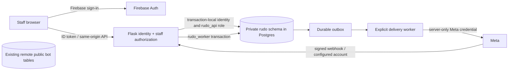

# Current local architecture

Updated 2026-11-20. This describes the **new local implementation**, not the unchanged production deployment. Original cPanel behavior is preserved as historical evidence in [CODEBASE_ANALYSIS.md](CODEBASE_ANALYSIS.md).

The disconnected public-table node is deliberate: the local app has no read-through, mirror or automatic migration bridge. Remote database access and actual delivery are disabled by default. The private schema is a local-tested draft; no remote DDL has been applied.

## Boundaries and access

- Browser: Firebase public client config plus ID token; no Redis, Meta or service-role credentials. API base follows the served application prefix. Browser profile/preferences remain device-local and UID-partitioned where appropriate; they are not authorization.
- API identity: Firebase Admin SDK with project/issuer/expiry/signature/revocation verification. Membership comes from the private database and is checked per request. No public signup or local role string grants staff access.
- Database: separate non-BYPASSRLS API/worker role grants, fixed schema queries, parameterized values and transaction-local subject/issuer. Direct server credentials are never sent to the browser. Production login provisioning remains unapproved/unperformed.
- Webhook: exact raw-body HMAC, payload/account checks, atomic inbox-plus-history acceptance, all events in a batch, idempotent provider IDs and sanitized errors. No AI routing, automatic reply or bot state replacement was added.
- Outbound: authorized conversation-bound enqueue, versioned history, explicit delivery state, worker-only external send. Sending/unknown outcomes require reconciliation before retry.
- Clinical: risk-triage.js remains unchanged. Flags are browser heuristics; a durable clinical escalation system is not implemented.

## API surface

| Route | Boundary |
|---|---|
| GET /api/me | Verified Firebase identity + active membership |
| GET/POST /api/conversations | Scoped operator/admin; paginated list or validated international-number creation |
| GET/PATCH /api/conversations/:id | Scoped history or version-checked lifecycle update |
| POST /api/conversations/:id/messages | Scoped idempotent queueing; no arbitrary-recipient send |
| GET /api/orders; PATCH /api/orders/:id | Scoped list and version-checked status |
| GET /api/referrals; GET /api/qr-analytics | Scoped operator/admin, explicit completeness guard |
| GET /api/analytics | Active staff aggregate counts; analysts receive no raw clinical records |
| POST /sendWhatsApp | Auth required, then 410; replaced by scoped conversation messaging |
| GET/POST /webhook | GET challenge token; POST Meta signature and configured account/facility |
| Approved HTML/assets | Public static UI code only; sensitive data always fetched through protected APIs |

Lists use bounded page sizes and explicit over-limit errors rather than silently incomplete totals. History currently has a 10,000-message completeness guard; very large threads require a future history-pagination UX. Process-local send rate limiting is not a distributed limiter.

See [LOCAL_IMPLEMENTATION.md](LOCAL_IMPLEMENTATION.md), [REMOTE_SCHEMA_COMPARISON.md](REMOTE_SCHEMA_COMPARISON.md) and [LOCAL_TEST_RESULTS.md](LOCAL_TEST_RESULTS.md) for differences, blockers and executed evidence.
