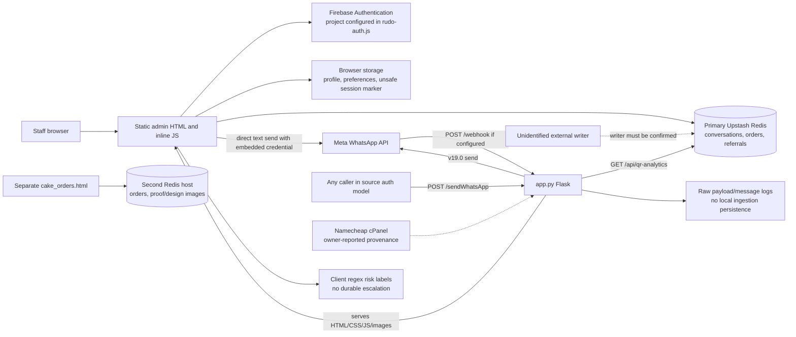
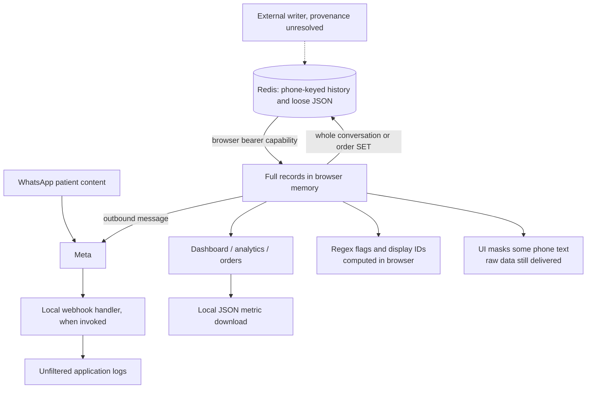
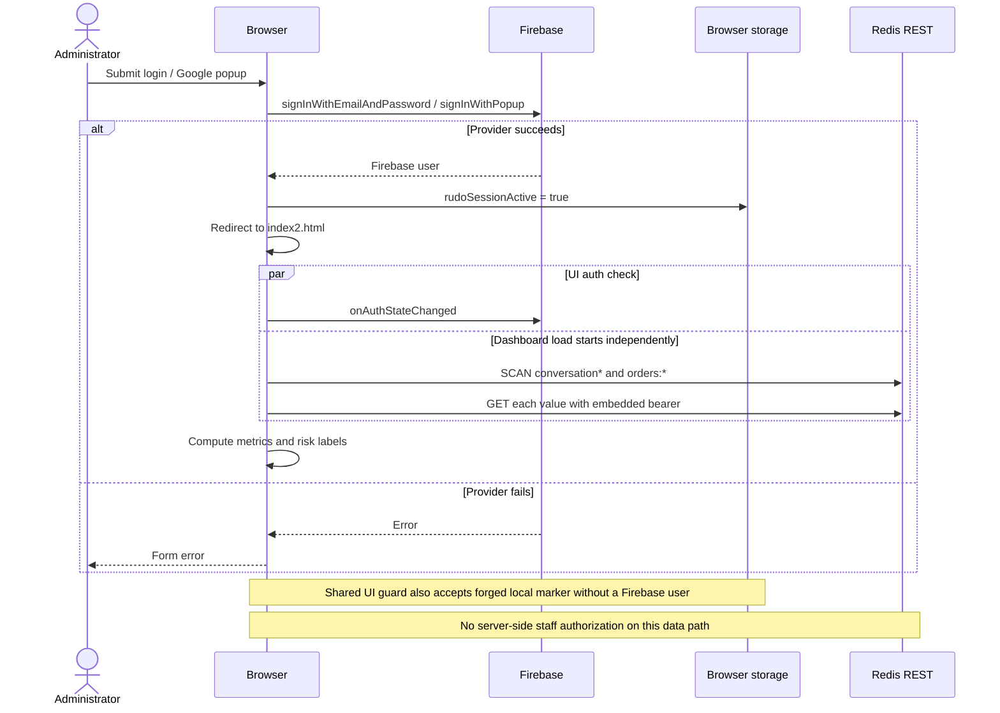
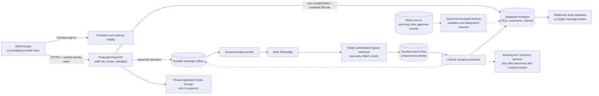
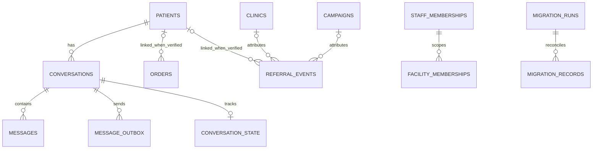

# Architecture and workflow diagrams

> Historical discovery baseline. Local implementation is now authorized and documented in [LOCAL_IMPLEMENTATION.md](LOCAL_IMPLEMENTATION.md); original source references below describe the audited snapshot. Remote execution remains pending review.

Date: 2026-11-20. Solid edges describe calls present in local source. Dashed edges describe owner-reported hosting or unresolved dependencies, or explicitly labeled proposals. These diagrams are source reconstructions, not observed production network traces. See CODEBASE_ANALYSIS.md for line references.

## Current architecture: verified source boundaries



No dashboard fetch to `/sendWhatsApp` or `/api/qr-analytics` was found. An edge from Meta to Flask is a supported handler, not proof it is the active registered callback. No local AI path was found.

## Current health-data flow and privacy boundaries



Phone masking in a display is not authorization or anonymization. Exported dashboard metrics are computed UI values, not verified database reports.

## Current administrator login and dashboard sequence



## Current incoming webhook and administrator send

```mermaid
sequenceDiagram
    participant M as Meta or unsigned caller
    participant F as Local Flask
    participant L as Logs
    participant B as Admin browser
    participant R as Redis
    M->>F: POST /webhook
    F->>F: Parse JSON; take first message per change
    F->>L: Full payload, sender and text
    F-->>M: 200 success, or 500 exception
    Note over F,R: No local webhook persistence, dedup or AI reply
    B->>B: Append optimistic bot message
    B->>M: Direct Graph messages POST with browser credential
    M-->>B: Provider JSON
    alt Provider reports success
        B->>R: SET entire conversation array
        Note over B,R: Write HTTP status not checked; concurrent updates can be overwritten
    else Send failure
        B->>B: Append system failure message locally
    end
```

## Proposed Supabase architecture (not implemented)



Staff Firebase-token forwarding requires configured Supabase third-party integration and explicit policies. Broad service keys bypass RLS; isolated worker/import operations must be separately authorized and minimized. Queue tables/worker hosting remain design proposals; do not assume Vercel or cPanel runs durable background jobs automatically.

## Proposed durable receive/send sequence (not implemented)

```mermaid
sequenceDiagram
    participant M as Meta
    participant H as Authoritative webhook
    participant DB as Postgres inbox and history
    participant W as Worker
    participant A as Protected staff API
    M->>H: Signed event batch
    H->>H: Verify exact raw-body signature and configured account
    H->>DB: Transactional insert of each event identity
    alt Durable acceptance succeeds
        DB-->>H: Accepted / already recorded
        H-->>M: 200 acknowledgement
        W->>DB: Atomic lease pending event
        W->>DB: Append message and versioned state
        W->>DB: Record completion; enqueue reply only when appropriate
    else Storage unavailable
        H-->>M: Retryable failure, no false durable acknowledgement
    end
    A->>A: Verify staff token, scope and idempotency key
    A->>DB: Persist outbound operation
    A-->>A: Return pending operation status to browser
    W->>DB: Lease outbound operation
    W->>M: Send using server-only credential
    alt Confirmed provider result
        M-->>W: Provider message ID / failure
        W->>DB: Store result and append ledger
    else Uncertain network outcome
        W->>DB: Mark unknown; reconcile before another send
    end
```

An idempotent local operation does not by itself guarantee exactly-once external delivery. Provider acceptance followed by process/network failure requires explicit uncertainty handling.

## Proposed entity relationships



Nullable associations deliberately avoid fabricating a patient/clinic link when legacy records do not prove it. Meta account/tenant scoping, inbox and audit entities are specified in SUPABASE_MIGRATION_PLAN.md; this diagram shows the core relationships only.
