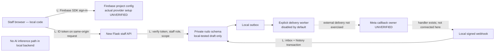
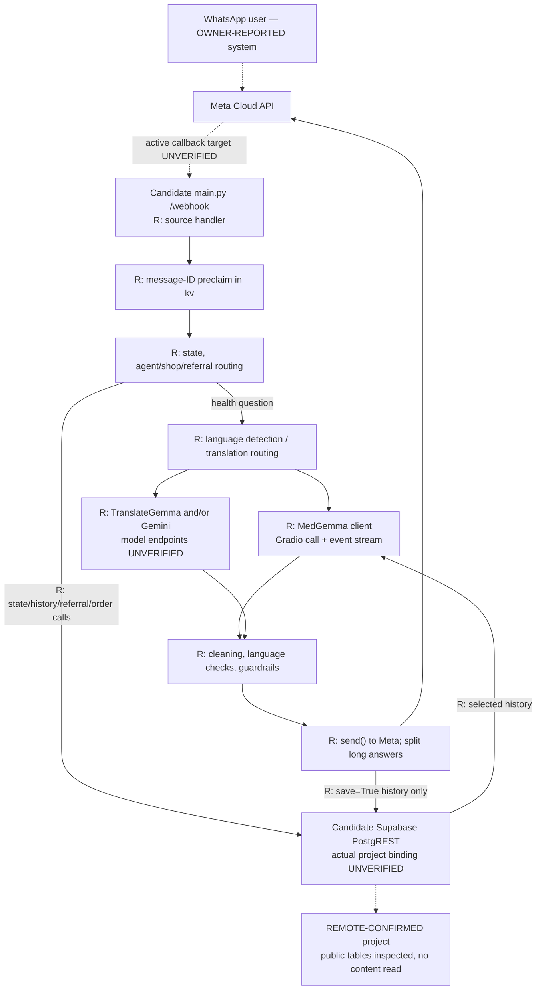

# Rudo integration architecture assessment

Date: 2026-11-20. Decision: **HOLD production integration; approve a bounded staging observer design first.** This assignment made documentation changes and authorized read-only catalog/public-source inspections only. It did not change application code, SQL migrations, clinical logic, remote records, credentials, webhook settings or deployments.

## Evidence classification

| Label | Meaning |
|---|---|
| REMOTE-CONFIRMED | Observed using the authorized linked Supabase project and explicit read-only SQL; limited to metadata |
| LOCAL-CONFIRMED | Present in the local source/configuration or retained synthetic test artifacts |
| REFERENCE-CONFIRMED | Present in the pinned public candidate bot source; its deployment is **UNVERIFIED** |
| OWNER-REPORTED | Provided in the assignment, such as a functioning existing WhatsApp bot or cPanel provenance |
| UNVERIFIED | No authoritative runtime/configuration evidence available; not inferred from filenames, schemas, estimates or repository documentation |

The linked project is `cktfbpnxpfbyroqzuibc`; a fresh read-only query returned PostgreSQL **17.6**. Six public tables exist. The private `rudo` schema and the two proposed runtime roles are absent remotely. [Catalog evidence](evidence/remote-metadata.json), [inspection SQL](evidence/inspect_metadata.sql), [database assessment](DATABASE_ASSESSMENT.md).

## What is positively established

| Component | Evidence | Confidence and limit |
|---|---|---|
| New dashboard API | `app.py:create_app`, lines 32–314; protected routes 156–262 | LOCAL-CONFIRMED; no deployed endpoint identified |
| Firebase token verification | `rudo/auth.py:FirebaseVerifier.verify`, lines 14–36; `app.py:authenticated`, 55–68 | LOCAL-CONFIRMED; actual project/ADC/provider setup **UNVERIFIED** |
| Staff/facility authorization | `rudo/db.py:transaction/membership`, 43–59; draft SQL `staff/allowed`, 20–39 and policies 134–168 | LOCAL-CONFIRMED; memberships/logins are not provisioned in the inspected remote schema |
| Dashboard persistence | `rudo/db.py`, queries name `rudo.*`; no public-table adapter | LOCAL-CONFIRMED; no bridge to remote bot tables |
| Incoming local webhook | `app.py:webhook`, 264–298; `rudo/db.py:accept_webhook`, 163–224 | Signature/account check and atomic local persistence; no inference or automatic answer generation |
| Local sending worker | `rudo/delivery.py:deliver_one/main`, 34–85 | Can call Meta when separately configured/enabled; not evidence of a running worker or authorized sender ownership |
| Supabase database | Fresh read-only catalog inspection | REMOTE-CONFIRMED database availability/schema; actual production bot binding and writers **UNVERIFIED** |
| Candidate bot | Public fork `Samuel04-png/rudo_medgemma`, HEAD `af2545c92aea2cbcda5c6d717f67598b386a373d` | REFERENCE-CONFIRMED; current public HEAD matches previously inspected bytes; actual deployed commit **UNVERIFIED** |
| Candidate hosting | Candidate `vercel.json:1–15`, `api/index.py:1–7` | Source config routes traffic to `main.app`; Vercel deployment/domain/account **UNVERIFIED** |
| Candidate AI services | `main.py:generate_reply`, 1286–1347; `medgemma_client.py:64–95`; translation client | Network contracts exist in source; service URLs, hosting, model/adapter build and availability **UNVERIFIED** |
| Namecheap/cPanel | Original assignment/provenance; historical audit | OWNER-REPORTED; no current WSGI/runtime/domain/active callback configuration available |

Only the remote database connection was runtime-observed in this audit. **No specific production bot, inference service, transport worker, Firebase provider configuration or webhook callback has been runtime-verified.** Database presence and nonempty planner estimates cannot establish which service is writing now.

The public repository is confirmed as a fork of `Dawa-Health/rudo_medgemma`; that establishes a repository relationship, not canonical deployment ownership. The referenced `supabase_schema.sql` remains absent from the fork's inspected tree. [Public source provenance](evidence/public-reference.json), [original module hashes](../REFERENCE_PROVENANCE.json).

## Current local implementation

`L` means source/local evidence, not a production network trace. Remote connection and delivery flags default to false (`app.py:34–44`, `rudo/delivery.py:73–82`). No relevant configuration variable names were present in the inspecting process, and only `.env.example` exists locally; this says nothing about hosting environment variables. The app does not read Supabase CLI connection secrets. Local supabase/config.toml:13 lists public/graphql_public API schemas; it is not evidence of remote Data API configuration.

## Candidate WhatsApp/AI flow — source reconstruction only

`R` arrows describe calls in the pinned reference. They are not proof those calls run against the linked project. Source locations: `main.py:_process_message` 2070–2120; `handle_message` 1927 onward; `generate_reply/answer_user` 1286–1369; `send/say` 200–234; `db.py:_call` 41–58. Actual AI/transport behavior must be checked against the owner's deployed commit before any integration.

## Persistence and state boundaries

| System | Source-level use | Runtime conclusion |
|---|---|---|
| Existing public Supabase tables | Candidate writes `users`, `messages`, `referrals`, `orders`, `kv` through PostgREST | Schema compatible in broad shape; writer and currentness **UNVERIFIED** |
| public.user_state | Present remotely, PK user_id; differs from users.state | No matching table access found in the inspected candidate db.py; producer/consumers **UNVERIFIED** |
| Candidate `redis_client` | Assigned `db.kv` at main.py:63–75; expiring handoff, rejection, session and message preclaim keys | This name does not prove Redis use; candidate implementation calls Supabase kv |
| Original cPanel Redis | Historical source audit: conversation arrays, loose orders/referrals, separate cake database | Historical evidence only; active databases/writers and TTLs **UNVERIFIED**; no Redis access attempted |
| New local rudo tables | Staff scope, dashboard history, inbox/outbox, orders/referrals, audit, migration provenance, expiry-aware state | Local implementation only; no remote schema or synchronization |
| Browser storage | UID-keyed display profile, session marker still written but ignored as authority, local settings | Not identity or business-data authority; no server permission is obtained from it |

The candidate stores selected AI-context history rather than every provider interaction: fixed UI text uses `save=False`; shop-step inputs are excluded; whole multi-part answers become one stored row; a bot row can be written after an HTTP send failure. See [WHATSAPP_INTEGRATION.md](WHATSAPP_INTEGRATION.md). A dashboard must label this limitation rather than promise a complete delivered transcript.

## Recommended connection boundary

Recommend **Option C: a narrowly controlled, initially read-only adapter** to the verified authoritative bot store, with private staff/scope/audit control metadata. Existing public tables are the leading source candidate because they exist and match the bot's source contract; their authoritative production status remains **UNVERIFIED**.

The first staging slice reads synthetic public-shaped history through the authenticated dashboard without registering a new webhook, enabling a new sender, copying inference history into a competing store or changing AI behavior. The existing full private-schema draft must be reviewed/revised for this narrower control-plane role before any remote application. [Database options](DATABASE_ASSESSMENT.md), [phased plan](INTEGRATION_PLAN.md).

## Runtime evidence still required

Obtain redacted Meta callback/subscription and authoritative sender configuration; hosting deployment ID/source commit and route mapping; approved non-secret project/account identifiers; deployed AI contracts/model versions and egress policy; actual Firebase project/provider configuration; service-to-table writer register and scheduled-job ownership. No passwords, tokens, credential JSON or patient samples should be pasted into chat.

Access to those consoles/configurations was not established in this session. Their inspection is stopped at this dependency; no guessed endpoint was contacted. A live database is the only positively confirmed operational infrastructure here.
