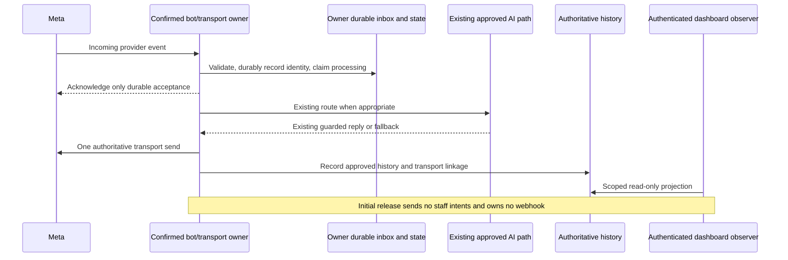

# WhatsApp ownership, AI continuity and message contract

Date: 2026-11-20. **No callback, sender, model, subscription or production record was changed or exercised.** All runtime owner fields below remain UNVERIFIED until supplied through an authorized configuration review.

## Ownership findings

| Question | Verified evidence | Conclusion |
|---|---|---|
| Who receives incoming Meta events? | New local handler `app.py:webhook` 264–298; candidate `main.py:webhook` 2123–2152 | Two code handlers exist; active registered callback/service **UNVERIFIED** |
| Who sends outbound messages? | Candidate `main.py:send` 200–229 and interactive sender 237 onward; local `MetaSender.send` 13–31 | Both implementations can send if configured; actual sender owner **UNVERIFIED** |
| Are multiple services consuming/sending now? | No Meta/hosting configuration or runtime trace available | **UNVERIFIED**; code existence is not evidence of duplicate production processing |
| Are provider IDs retained? | Candidate sends discard response IDs; public.messages has no provider/account column; candidate preclaim stores inbound IDs in kv keys | No complete transport ledger verified; actual deployed behavior **UNVERIFIED** |
| What happens to statuses? | Candidate webhook ignores statuses at main.py:2147–2148; local inbox/history handles them | Local capability does not prove a production status subscriber exists |
| What happens on retry? | Candidate preclaims IDs for one hour; local inbound transaction deduplicates and persists together | Different semantics; neither proves the active production retry contract |
| Can dashboard observation preserve AI? | A read adapter can query verified source history without owning callbacks/sends | Feasible design, not implemented; no complete-transcript promise until source limitations are resolved |

## Candidate AI path, precisely bounded

Pinned candidate source: [af2545c92aea2cbcda5c6d717f67598b386a373d](https://github.com/Samuel04-png/rudo_medgemma/tree/af2545c92aea2cbcda5c6d717f67598b386a373d). Its deployed status is **UNVERIFIED**. Current HEAD and cached source hashes match; parent/fork relationship is recorded in [public-reference.json](evidence/public-reference.json).

1. `main.py:_process_message` 2070–2120 reads sender/account metadata, checks an inbound preclaim, handles agent buttons/non-text messages and active human relay, loads state, stores selected user history/referral data, then calls `handle_message`.
2. `handle_message` 1927 onward routes onboarding, greetings/reset, handoff and shop state separately from free-form questions. A dashboard must not send those messages into a new inference route.
3. `answer_user` 1350–1369 optionally sends a thinking message, calls `generate_reply`, chooses failure text if needed, sends a reply and may ask a follow-up.
4. `generate_reply` 1286–1347 performs configured translation to English when needed, selects recent history, calls MedGemma, cleans output, checks language and may retry without history, translates back, then calls `compose_reply` using original/translated question text.
5. `medgemma_client.py:64–95` uses Gradio POST `.../call/answer`, obtains an event ID, and reads an event stream. This is not the README's simple JSON `/answer` assumption. `pairs_from_history` 19–33 selects up to two prior user/model pairs; do not change that context selection as a dashboard integration side effect.
6. `translategemma_client.py:38–47,165–195,333–383` selects TranslateGemma and/or Gemini by language/direction and supports fallback/review. Gemini may receive question/answer content for translation, beyond language classification. Actual configured routing, endpoints and processors are **UNVERIFIED**.
7. `medgemma_guardrails.py:86–116` performs output cleaning and regex-based referral/self-harm response composition. These are source behaviors, not evidence of clinical validation. This audit did not change, run against patients, or endorse clinical wording/rankings.

Actual model/adapter builds, inference hosting, data retention, supported language quality, fallback performance and safety approval are **UNVERIFIED**. Public reference URLs/README claims do not establish that a model service is running.

## History is not yet a complete transport transcript

Source observations with integration consequences:

- `send(..., save=False)` and `say` exclude fixed UI messages, including welcome/greeting/reset/handoff/failure/thinking flows (`main.py:200–206,232–234,1353–1363`).
- Shop-step incoming messages are excluded from history (`main.py:2110–2113`). An order can therefore have relevant interactions absent from public.messages.
- A long answer is split into multiple Meta requests but saved as one answer after the loop (`main.py:215–228`). A public history row is not necessarily one provider message.
- HTTP >=400 is logged, but the bot history write can still occur (`main.py:224–228`). A bot-role row is not proof of successful send, delivery or read.
- Provider response IDs are not persisted by the inspected send implementation. Existing public message IDs cannot be converted into wamid values from body/time matching.
- Internal `message_en` serves the model context and can be patched after translation (`db.py:179–191`). It is not a separate clinician-validated message.

Initially label the dashboard **captured bot history**, show source/coverage limitations, and leave unknown delivery states unknown. A complete transcript/operational messaging ledger needs a separately approved owner-side capture contract. Do not backfill omitted fixed UI or failed staff messages into the model context to make the dashboard look complete.

## Reliability risks to address in the authoritative owner

| Source | Source-derived risk; production occurrence UNVERIFIED |
|---|---|
| Candidate main.py:2024–2036 | Preclaim before processing, one-hour expiry and fail-open storage errors can suppress unfinished work or allow duplicate processing; a preclaim is not a completion record |
| Candidate main.py:2140–2152 | Processing exceptions are acknowledged with HTTP 200, potentially losing retryable work |
| Candidate db.py:108–176 | Persistence failures may become empty state/history or swallowed writes; new UI must not interpret failures as empty healthy data |
| Candidate main.py:343–374 | Agent accept is read-modify-write, with no atomic winner/fencing visible; simultaneous acceptance can race |
| Local rudo/db.py:190–196 | The tested no-regression case protects read and delivered→sent, but a delayed failed event can replace delivered; provider event time is not a dedicated inbox field |
| Local rudo/delivery.py:55–63 | Status lookup before message insertion has a race: a status can commit after lookup and update zero rows before the send-result insert; later reconciliation is needed |
| Local rudo/delivery.py:41,53–54,67–70 | Stale claims become unknown, but final updates lack a claim/fencing token; an old worker completion can overwrite a reconciler's newer state |

These are audit findings, not claims that the reported 54 tests failed. Those tests cover specific synthetic cases; the new race/order cases require additional staging tests after implementation approval. No fixes were made in this audit.

## Proposed authoritative-owner contract

**Contract status: PROPOSED, not configured.** Bind each messaging account/phone-number ID to one named deployed processing owner, source commit and operational team. Until verified, retain the owner-reported functioning bot and do not point Meta to this local backend.

| Concern | Required contract |
|---|---|
| Inbound ownership | One authoritative callback ingress validates signatures and configured account, durably accepts work and deduplicates event identity before acknowledging |
| Processing ownership | Owner serializes per-conversation state transitions and routing; message reception alone does not trigger a second dashboard inference pipeline |
| AI continuity | Owner retains exact approved model/translation/guardrail/history behavior during observer rollout; no simultaneous backend replacement |
| Sending ownership | One transport owner sends AI replies, approved staff intents and human relay. Dashboard submits intent to that owner; it does not independently call Meta |
| Human takeover | Owner enforces an atomic handoff/ownership epoch before AI or staff send; UI closed/resolved status is not an AI suppression or human handoff signal |
| Durable IDs | Record configured account, inbound provider ID, logical outgoing operation ID, each send attempt/provider ID/chunk and source-record linkage. Preserve original public IDs as lineage |
| Unknown legacy data | Mark provider/delivery/account attribution unknown until proven. Do not derive IDs or clinical ownership by matching content, phone country or QR campaign |
| Retry | Persist processing completion/lease, bounded retries and dead-letter/repair state; uncertain provider acceptance requires reconciliation, not blind resending |
| Status events | Persist minimal status identity, provider occurrence time and received time; reconcile early/out-of-order events without regressing established delivery evidence |
| Privacy | Keep health text in approved restricted stores; audit/monitor only safe metadata, never tokens, raw prompts, phone-bearing keys or provider response bodies |

The current local worker must remain disabled for production accounts while another transport owner operates. Consolidating transport into a separate service is a possible later project; it must be explicitly assigned and staged, not introduced indirectly by dashboard rollout.

## Lifecycle and API proposal

For a later approved messaging slice, a staff intent should contain an operation UUID, authorized source conversation/account reference, actor identity derived server-side, message type/body reference, and expected ownership/version. The owner rechecks staff scope and handoff epoch and returns operation status. A read endpoint may return pending/accepted/failed/unknown and proven provider status without implying exactly-once delivery.

Proposed event states distinguish queued, claimed, provider-accepted, provider-sent, delivered, read, failed and unknown. Retain append-only attempt/status evidence and derive current state by a reviewed rule; HTTP 200 + provider ID means accepted, not delivered. Every split chunk needs linkage to its logical operation. The existing local API/status vocabulary will need review against this contract before sending is enabled.

## Evidence required before selecting the owner

Obtain approved redacted Meta callback/subscription configuration, account/phone-number IDs, sender credential principal names without values, deployed application/source commit, scheduler/worker topology and a synthetic staging correlation trace. A configuration owner can provide public hostnames and IDs; no tokens or patient conversation are needed here.

No access to Meta, Vercel/cPanel or inference-host configuration has been established. Those lookups are stopped at the access dependency. The safest immediate implementation after approval is a synthetic staging **read-only observer**; webhook/sender changes remain a later, separately authorized stage.
